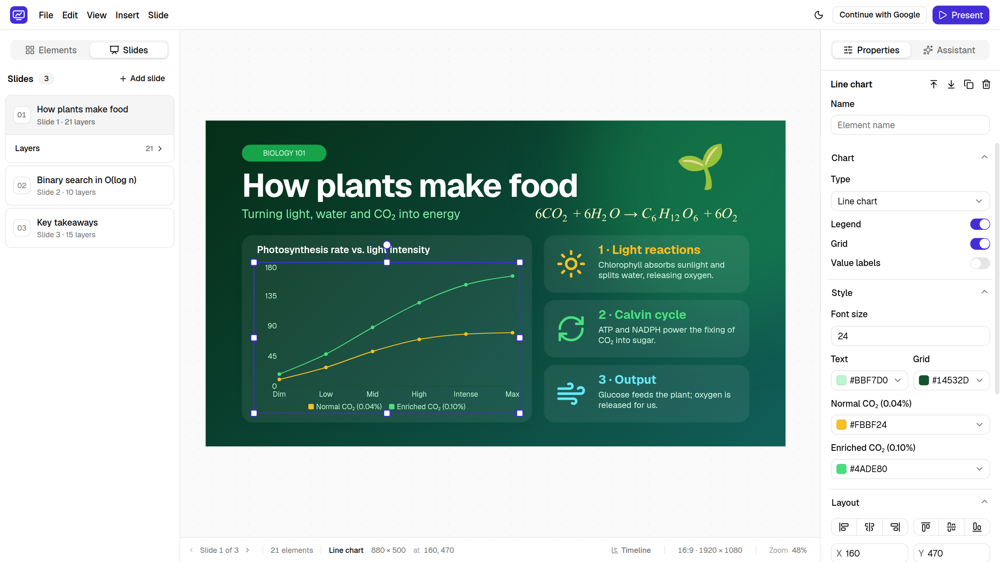
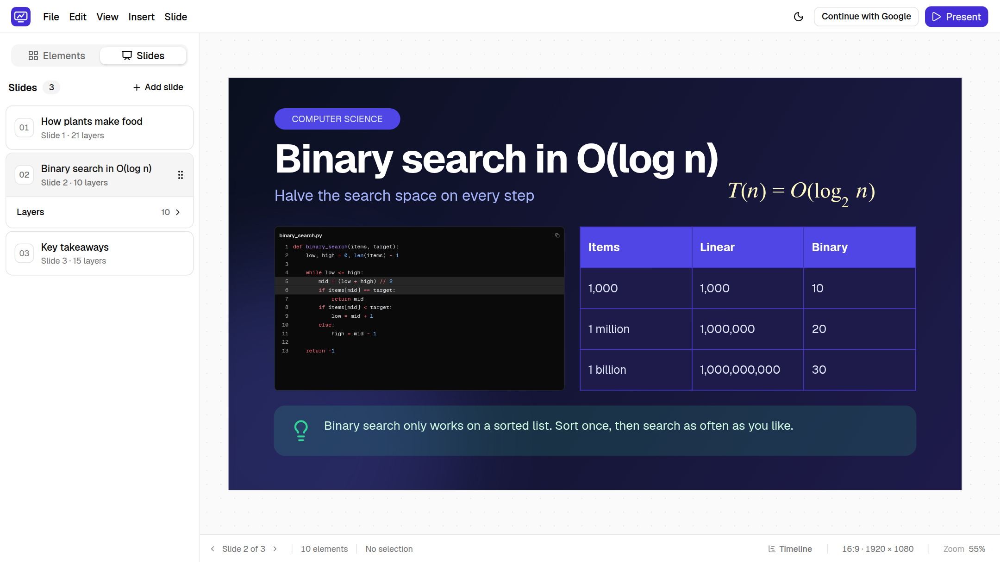
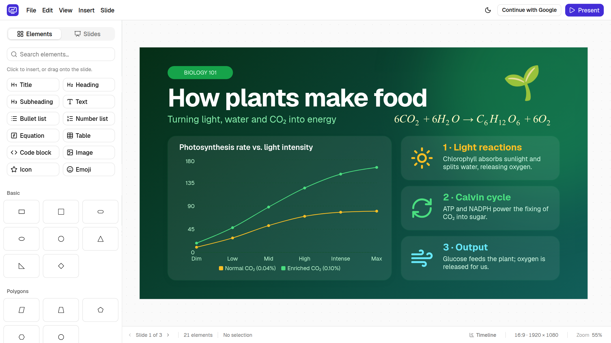
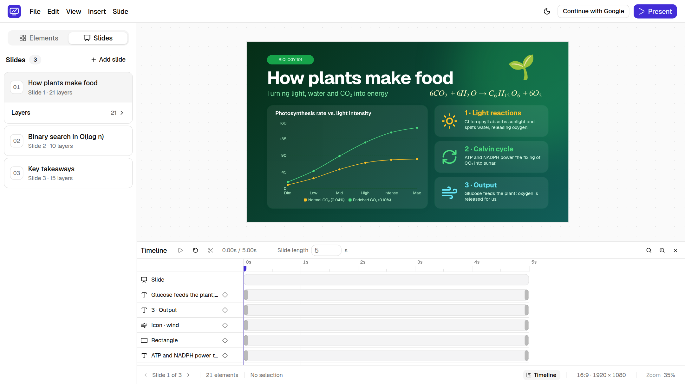
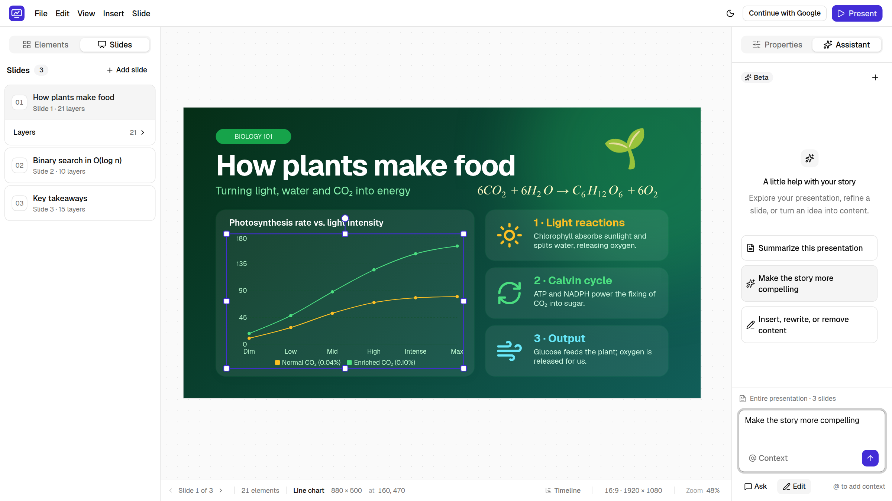
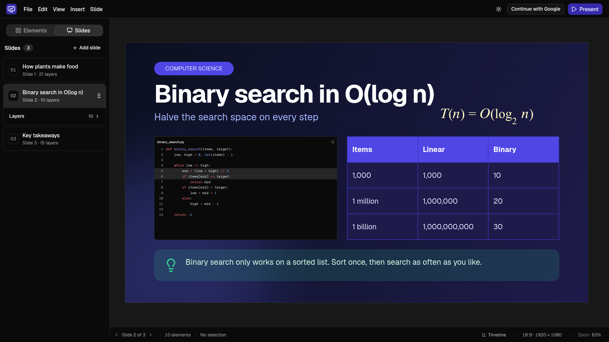
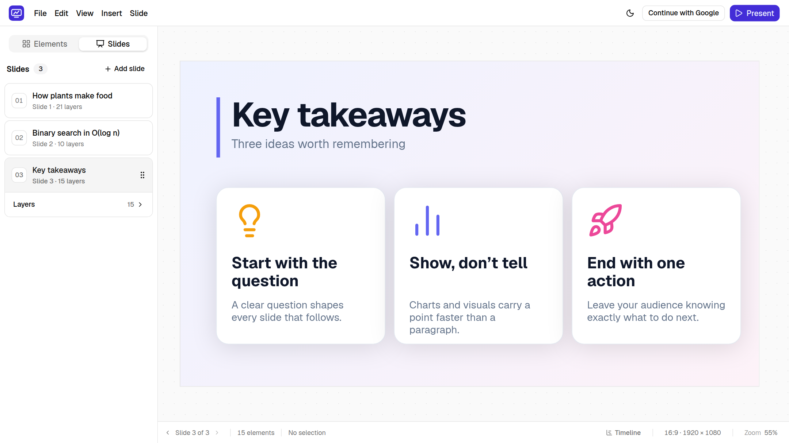

# Slidx

**Design, animate and present slides in your browser.**

A fast, visual slide editor with a timeline, charts, code blocks, equations and an AI assistant — no install, and your work stays yours.

## Features

### A real design canvas

- **Drag, resize, rotate and group** anything on a 16:9 canvas, with smart alignment guides, snapping and an optional grid.
- **Layers panel** to rename, reorder, lock and organise every element on a slide.
- **Fine control**: opacity, shadows, blur, brightness, grayscale, blend modes, flips and gradient or image backgrounds.
- **Slide sizes** for widescreen, standard 4:3, square, portrait and A4, resized without breaking your layout.

### Everything a presentation needs

- **Text** with titles, headings, bullet and numbered lists, and rich formatting.
- **Shapes**: dozens of built-in shapes with solid or gradient fills, strokes, dashes and text inside.
- **Charts**: bar, horizontal bar, line, area, pie, donut and radar, edited with a simple data table.
- **Tables** with header styling, borders and alignment.
- **Equations** written in LaTeX and rendered beautifully.
- **Code blocks** with syntax highlighting for many languages, line numbers, highlighted lines, and a light or dark theme that stays the same whatever your app theme.
- **Images, icons and emoji**, with masks, zoom and focus for pictures.
- **Slide layouts** such as title slide, section header, two content and comparison to start from.

### Bring slides to life

- **Timeline** showing when each element appears and disappears on a slide.
- **Enter and exit animations**: fade, slide, zoom, blur, bounce, wipe, typewriter and more, with adjustable duration and easing.
- **Keyframes** to animate position, size, rotation, opacity and effects exactly the way you want.
- **Present** full screen from any slide, with animations playing live.

### An assistant that knows your deck

- **Ask** questions about your presentation, get a summary, a critique or ideas for improving a slide.
- **Edit** with plain language: rewrite copy, restructure a slide, add a chart or a new slide.
- **Review before anything changes.** Edits are shown as a list of proposed changes that you apply or dismiss.
- **Focus the assistant** by adding specific slides or selected elements as context with `@`.

### Yours to keep and share

- **Works without an account.** Presentations are saved automatically in your browser.
- **Sign in with Google** to keep your presentations in your own dashboard and open them anywhere.
- **Export** the current slide as **PNG** or **HTML**, or the whole deck as **PDF** or a single **HTML** file.
- **Save to file and open it again** whenever you like.
- **Light and dark themes** for the editor.

## Quick tour

1. Start a new presentation, or pick a slide layout.
2. Add content from the **Elements** panel, by clicking or dragging onto the slide.
3. Fine-tune the selected element in **Properties**.
4. Open the **Timeline** to choreograph when things appear.
5. Ask the **Assistant** to tighten your wording or build a slide for you.
6. Hit **Present**, or export your slides.
